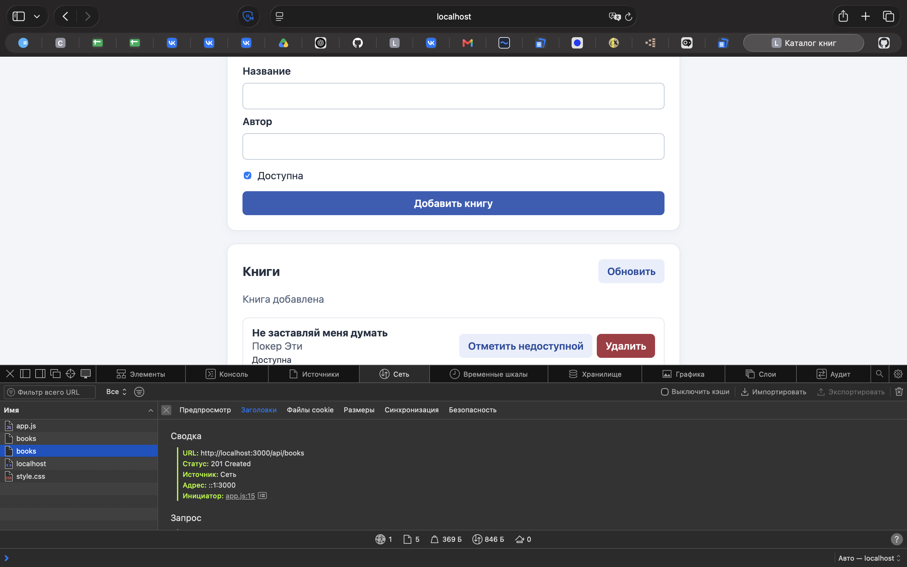
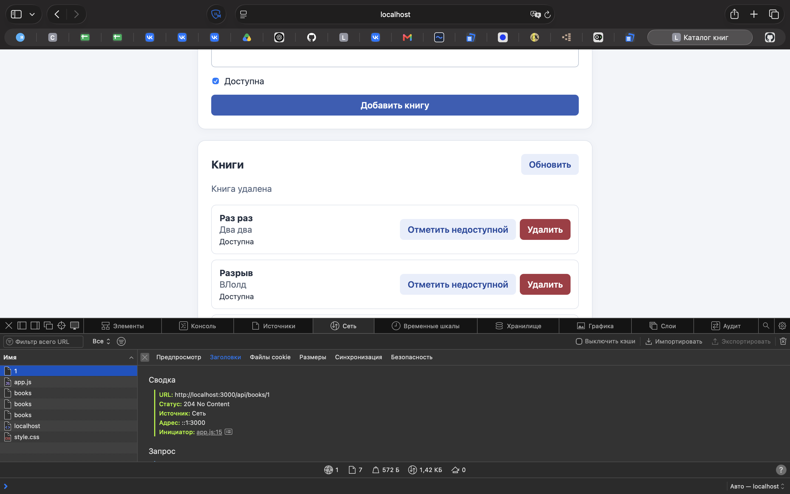

# ЛР7. Интерфейс каталога книг

## Запуск

```bash
npm install
npm start
```

Страница: `http://localhost:3000`.

## Структура

- `server.js` — Express, API и SQLite.
- `public/index.html`, `public/style.css`, `public/app.js` — интерфейс.
- `package.json`, `package-lock.json` — зависимости.
- `.gitignore` — исключение `node_modules` и `data.db`.

Браузер → `fetch()` → Express API → SQLite → JSON → `render()` → DOM.

## Действия и маршруты

| Действие | Маршрут |
|---|---|
| Загрузить и обновить список | `GET /api/books` |
| Добавить книгу | `POST /api/books` |
| Изменить доступность | `PATCH /api/books/:id` |
| Удалить с подтверждением | `DELETE /api/books/:id` |

Все действия выполняются без перезагрузки страницы. Название и автор выводятся через `textContent`, чтобы пользовательский текст не выполнялся как HTML.

## Проверка

Пустое название при POST вернуло 400; несуществующий ID при GET и DELETE — 404. После перезапуска сервера созданная книга сохранилась в SQLite. DELETE вернул 204 без тела.



